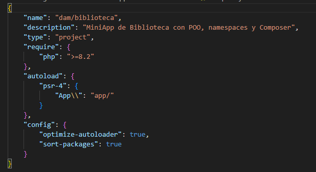
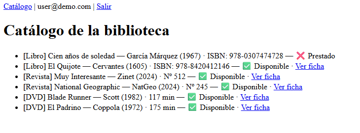
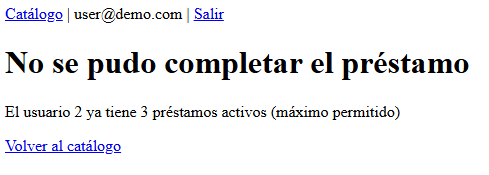
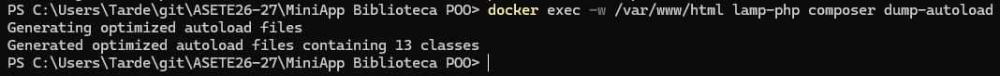
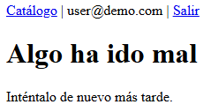

# Reflexión — Actividad 2.2

## Autoloading, namespaces y excepciones

**Nombre:** Ernesto de Jesús Beltrán Marmolejos
**Repo:** [Repositorio ASETE26-27](https://github.com/edebm34/ASETE26-27/tree/main/MiniApp%20Biblioteca%20POO)

### 1. Namespaces: ¿qué problema resuelven? Pon un ejemplo de colisión.

Los namespaces sirven para organizar las clases y evitar que haya
problemas si dos clases tienen el mismo nombre. Por ejemplo, podemos
tener dos clases llamadas `Libro`, pero en namespaces distintos. Así PHP
puede diferenciarlas.

### 2. PSR-4: explica cómo Composer sabe que `App\Classes\Libro` está en `app/Classes/Libro.php`.

Composer mira la configuración del archivo `composer.json`. Ahí se le
indica que las clases que empiezan por `App\` están dentro de la carpeta
`app/`. Después busca las carpetas y el archivo según el nombre de la
clase.

### 3. Autoloading: ¿qué diferencia hay entre `require_once` manual y el cargador de Composer?

Con `require_once` tenemos que escribir a mano qué archivos queremos
cargar. Composer lo hace automáticamente cuando necesitamos una clase.
Así ahorramos código y tenemos los archivos mejor organizados.

### 4. Excepciones: ¿qué ventaja tiene lanzar `MaterialNoEncontradoException` en lugar de devolver `null`?

La excepción permite saber claramente qué ha pasado: que no se ha
encontrado el material. Si devolvemos `null`, puede ser más difícil
saber cuál ha sido el problema. Además, podemos capturar la excepción y
mostrar un mensaje.

### 5. Try/catch: ¿dónde capturas las excepciones y por qué ahí? ¿Qué pasa si no las capturas?

Las capturaría en la parte del programa que controla lo que ocurre, por
ejemplo, en el controlador. Así puedo mostrar un mensaje si algo falla.
Si no se captura una excepción, puede detenerse el programa y aparecer
un error.

### 6. `Throwable` vs `Exception`: ¿cuándo usarías cada uno?

Usaría `Exception` para errores que puedo controlar, como cuando no se
encuentra un material. Usaría `Throwable` si quiero capturar tanto las
excepciones como otros errores de PHP. `Throwable` es más general.

### 7. `finally`: pon un ejemplo de tu código donde se ejecute `finally`. ¿Por qué es útil?

``` php
try {
        if (!$material->isDisponible()) {
            throw new MaterialNoDisponibleException($material->getTitulo());
        }

        $material->prestar();
        $this->repo->setDisponible($materialId, false);
        $this->repo->registrarPrestamo($materialId, $usuarioId);
    } finally {
        $material->log(
            "Intento de préstamo de '{$material->getTitulo()}' al usuario {$usuarioId}"
        );
    }
```

Es útil porque se ejecuta tanto si todo va bien como si ocurre una
excepción. Así se registra en el log sí o sí, evitando perder información en el registro a causa de una excepción.

### 8. PSR-12: cita tres reglas que hayas aplicado y explica por qué mejoran la legibilidad.

-   Usar cuatro espacios para separar el código y que quede ordenado.
-   Poner las llaves de apertura de clases y métodos en una línea nueva.
-   Dejar espacios alrededor de los operadores, por ejemplo, `=` o
    `===`.

Estas reglas hacen que el código sea más limpio y fácil de leer.

### 9. `strict_types`: ¿qué cambia respecto al comportamiento por defecto? ¿Por qué es una buena práctica?

Con `declare(strict_types=1);`, PHP comprueba los tipos de forma más
estricta en los argumentos y valores devueltos por las funciones. Sin
esto, PHP puede convertir algunos tipos automáticamente. Es buena
práctica porque ayuda a encontrar errores y evita conversiones
inesperadas.

### Ampliación A1 · Límite de 3 préstamos activos por usuario

En esta ampliación he hecho que un usuario no pueda tener más de 3 libros, revistas o DVDs prestados a la vez. Si intenta pedir uno más, el programa se lo impide y lanza un error propio llamado `LimitePrestamosException`, que creé con el mismo formato que la excepción que ya había para cuando un material no está disponible.

Para saber cuántos préstamos tiene un usuario, añadí al repositorio un método llamado `contarPrestamosActivos`, que le pregunta a la base de datos cuántos préstamos de ese usuario todavía no se han devuelto. Un préstamo cuenta como no devuelto cuando su fecha de devolución está vacía. Después, en el servicio de préstamos, antes de prestar nada, miro ese número y, si ya es 3 o más, lanzo la excepción. El 3 lo guardé en una constante para no tenerlo escrito suelto en el código como un número mágico y poder cambiarlo fácilmente.

Puse la comprobación en el servicio y no en el repositorio porque el repositorio solo sirve para hablar con la base de datos, y decidir cuántos préstamos son demasiados es una regla de la biblioteca, que corresponde al servicio. Usé una excepción en lugar de devolver simplemente `false` para poder saber por qué se rechaza el préstamo y así mostrar el mensaje adecuado en cada caso. La comprobación está dentro del bloque `try` para que el `finally` anote en el log también los intentos que fallan por el límite.

## Capturas de pantalla

### Composer con autoload


### App funcionando sin require-once


### `try/catch` funcionando


### dump-autoload


### Manejador global



## Autoevaluación

He aprendido para qué sirven los namespaces y cómo Composer carga las
clases automáticamente. También he entendido mejor cómo usar las
excepciones para controlar errores y algunas reglas para escribir código
más ordenado. Creo que necesito seguir practicando estos conceptos para
manejarlos con más facilidad.
