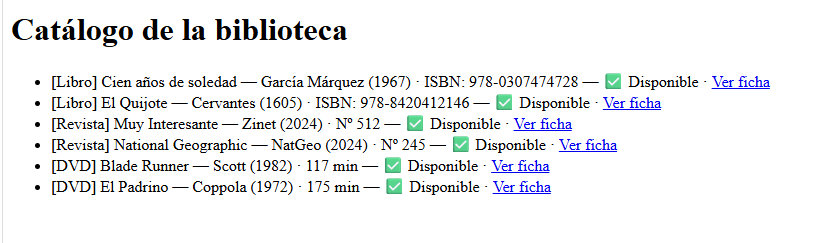
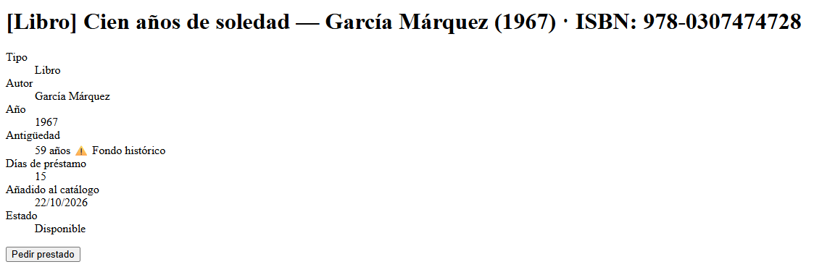
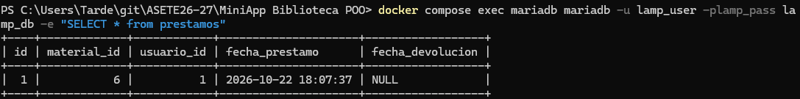
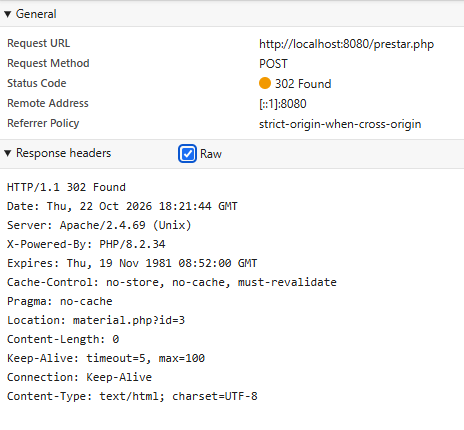

# Reflexión — MiniApp de Biblioteca (POO en PHP)

**Nombre:** Ernesto de Jesús Beltrán Marmolejos

### 1. Encapsulación: ¿por qué los atributos de `MaterialBiblioteca` son `private`? Ejemplo de bug que se evita

Los atributos (`id`, `titulo`, `autor`, `anio`, `disponible`) son `private` para que solo la propia clase controle su estado. El resto del código tiene que pasar por métodos (`prestar()`, `devolver()`, getters y setters), que son los que mantienen las reglas. Si `disponible` fuera `public`, cualquier script podría hacer `$m->disponible = true;` sin pasar por `prestar()` ni `devolver()`. El objeto diría que está disponible mientras en la tabla `prestamos` hay un préstamo activo, o se podría prestar dos veces el mismo material. Con `private`, la única forma de cambiarlo es `prestar()`, que antes comprueba `if (!$this->disponible) return false;`.

### 2. Herencia: ventaja de que `Libro`, `Revista` y `DVD` hereden de `MaterialBiblioteca`

Reutilización de código. Los atributos comunes, el constructor, los getters, `prestar()`/`devolver()`, `mostrarFicha()`, `antiguedad()` y los traits se escriben una sola vez en la clase base. Cada subclase solo añade lo suyo (`isbn`, `numero`, `duracionMin`) y sobrescribe lo que cambia (`tipoMaterial()`, `mostrarFicha()` y, en `DVD`, `diasPrestamo()`).

Además, los tres se pueden tratar como un mismo tipo: `MaterialRepo` devuelve un `array` de `MaterialBiblioteca` y `findById()` devuelve `?MaterialBiblioteca`. Y si se corrige un error en `prestar()`, queda corregido para los tres tipos a la vez.

### 3. Polimorfismo: qué pasa cuando el `foreach` llama a `$m->mostrarFicha()` sin saber el tipo

En `index.php` el `foreach` recorre objetos que, para el código del catálogo, son simplemente `MaterialBiblioteca`. En el momento de la llamada, PHP decide qué versión de `mostrarFicha()` ejecutar según la clase real del objeto (enlace dinámico): `Libro` añade el ISBN, `Revista` su número y `DVD` su duración, y todas empiezan llamando a `parent::mostrarFicha()`.

El `foreach` no tiene ningún `if` ni `instanceof`: la misma llamada produce un comportamiento distinto según el objeto. Es polimorfismo por sobrescritura (override).

### 4. Interfaces: diferencia entre `Prestable` (interfaz) y `Loggable` (trait). Cuándo usar cada uno

- `Prestable` es un contrato. Solo declara firmas (`prestar()`, `devolver()`, `diasPrestamo()`) sin código. La clase que la implementa está obligada a implementarlas, y cada una puede hacerlo a su manera (15 días por defecto, 3 en `DVD`). Define un tipo: se puede exigir "cualquier `Prestable`".
- `Loggable` es un trait. Aporta código ya escrito (`log()`) que se incorpora a la clase con `use`, sin obligar a nada ni definir un tipo. Sirve para reutilizar el mismo código en clases que no están relacionadas por herencia, ya que PHP no tiene herencia múltiple.

Usaría una interfaz cuando quiero garantizar que clases distintas ofrecen cierta operación, aunque cada una la implemente diferente. Usaría un trait cuando varias clases necesitan exactamente el mismo código (fechas, logging).

### 5. Repositorio: por qué el SQL está en `MaterialRepo` y no dentro de `Libro`

Por separación de responsabilidades. `Libro` es dominio (qué es y qué puede hacer un libro). El SQL, PDO y los nombres de tablas y columnas son persistencia. Si el SQL estuviera en `Libro`, la clase dependería de la base de datos, no se podría usar ni probar sin conexión y cada tipo repetiría sus consultas.

Con `MaterialRepo` hay un único sitio que cambiar si cambia la tabla o el motor, y las consultas preparadas quedan centralizadas. Además, el repositorio es el que decide qué subclase instanciar según la columna `tipo` (el `match` de `hidratar()`), algo que un `Libro` no puede hacer porque no conoce a `Revista` ni a `DVD`.

### 6. Integración: cómo se relacionan los objetos con `$_SESSION['user']` en `prestar.php`

`$_SESSION['user']` guarda los datos del usuario logueado (id, email…), accesibles con `currentUser()`, y `requireLogin()` corta la petición si no hay sesión. No es un objeto de dominio, solo datos.

El flujo de `prestar.php` es:

1. El repositorio devuelve el objeto con `findById($id)`.
2. `$material->prestar()` aplica la regla de negocio en memoria y devuelve `true` o `false`.
3. Si devuelve `true`, el repositorio persiste el cambio: `setDisponible($id, false)` y `registrarPrestamo($id, currentUser()['id'])`, que inserta en `prestamos` la fila (`material_id`, `usuario_id`).

Objeto y sesión se encuentran únicamente por el id del usuario, que es la clave foránea de `prestamos`. Por último, `log()` registra el email del usuario. El navegador se identifica con la cookie `PHPSESSID`, y con ella el servidor localiza `$_SESSION`.

### 7. Java vs PHP: tres diferencias concretas

1. **Sintaxis de acceso.** En Java `libro.getTitulo()`; en PHP `$libro->getTitulo()`. Las variables llevan `$` y dentro de la clase hay que escribir siempre `$this->` para acceder a los atributos.
2. **Importación de clases.** En Java se resuelven con `import` y paquetes. En PHP hay que hacer `require_once` del archivo a mano (por ejemplo, `MaterialRepo.php` requiere `Libro.php`, `Revista.php` y `DVD.php`) y, si falta, falla en ejecución.
3. **Constructores y colecciones.** En PHP no hay sobrecarga de constructores: se usan parámetros con valor por defecto (`bool $disponible = true, int $id = 0`) y la llamada al padre es explícita con `parent::__construct(...)`. Tampoco hay genéricos: un `array` hace de `ArrayList`.

### 8. Diseño: si mañana añadiéramos `Mapa` como nuevo tipo, qué archivos se tocarían

Se tocarían tres:

- **`src/classes/Mapa.php`** (nuevo): `class Mapa extends MaterialBiblioteca`, con su atributo propio (por ejemplo `escala`), `tipoMaterial()` y `mostrarFicha()`, y `diasPrestamo()` solo si tuviera un plazo distinto.
- **`src/repos/MaterialRepo.php`**: el `require_once` de `Mapa.php` y una rama `'mapa' => new Mapa(...)` en el `match` de `hidratar()`.
- **`mariadb/init.sql`**: añadir `'mapa'` al `ENUM` de `tipo`, la columna `escala` y algún registro de ejemplo. Como `init.sql` solo se ejecuta con el volumen vacío, en una base ya creada habría que hacer un `ALTER TABLE` o recrear el volumen.

No habría que tocar `index.php`, `material.php`, `prestar.php`, `MaterialBiblioteca`, `Prestable` ni los traits: `Mapa` hereda `prestar()`, `devolver()`, las fechas y el log, y el catálogo lo muestra gracias al polimorfismo.

# Capturas de pantalla

## Catálogo

## Ficha de un material

## Préstamo reflejado en BD

## Respuesta prestar.php
